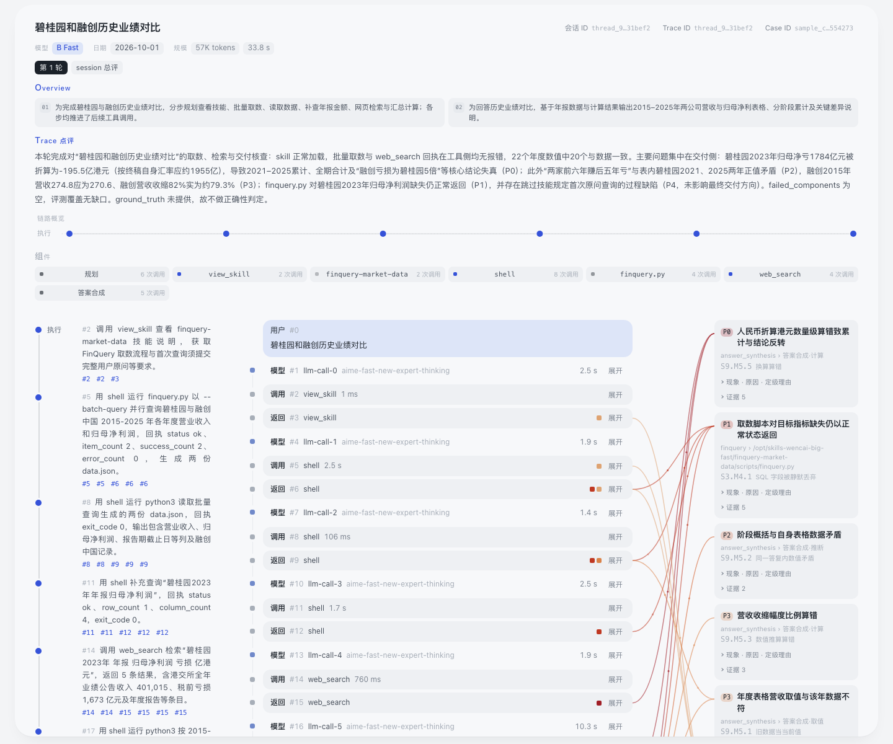
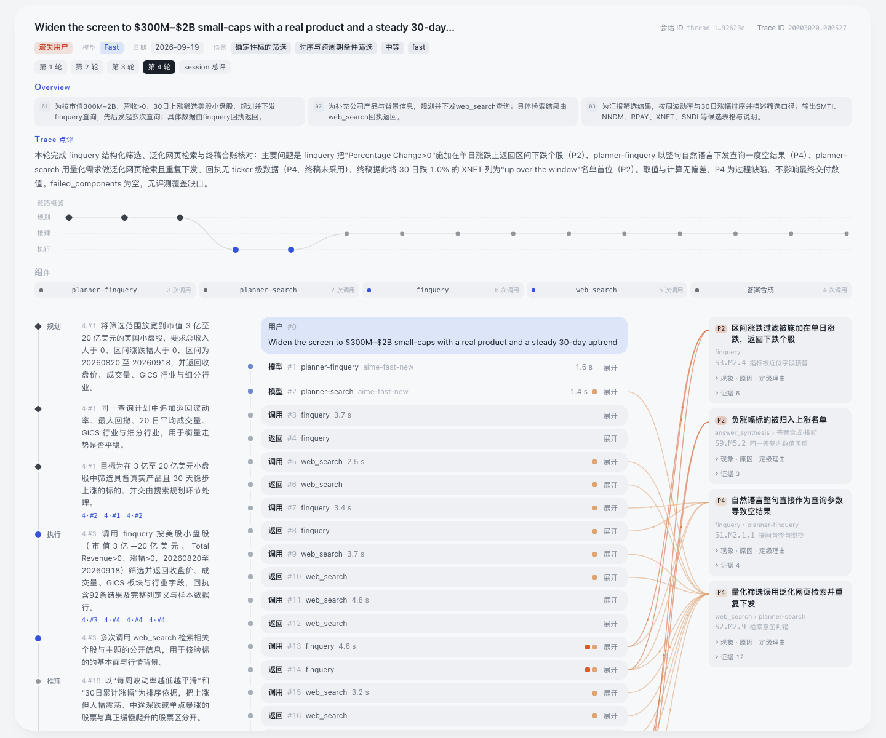
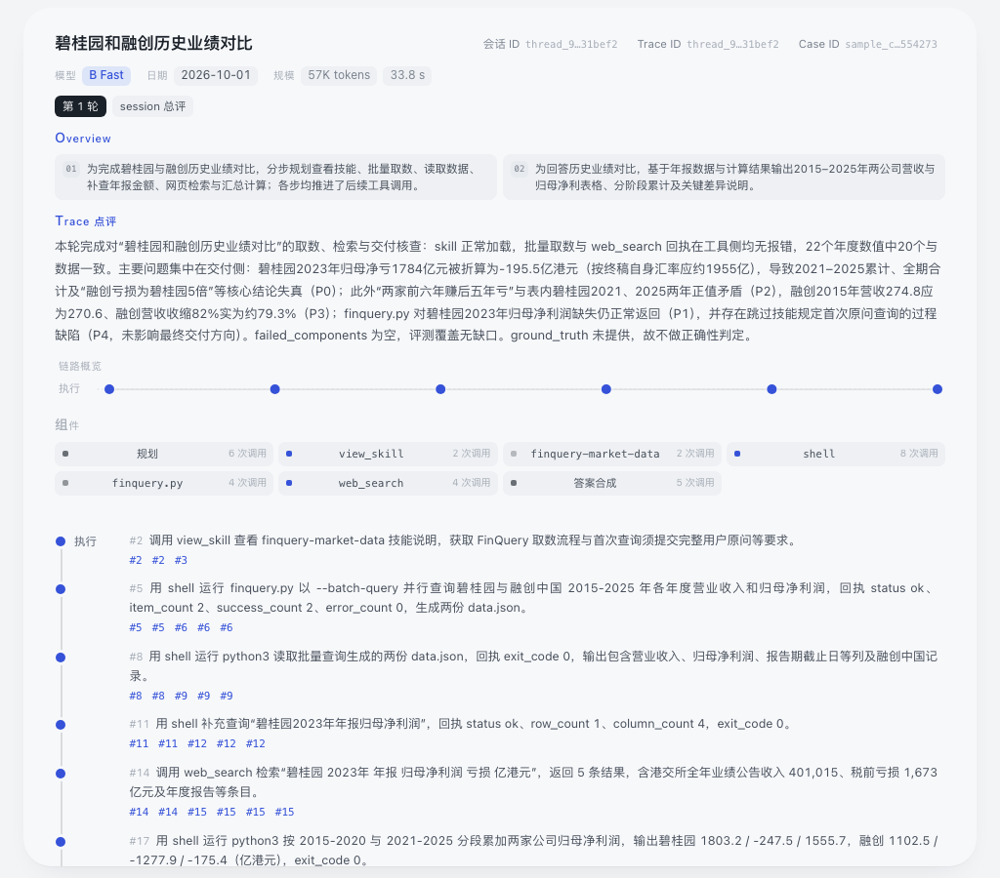

# 样本详情独立页（page_service/sample_details）

把看板「具体数据」页右侧的 pane（评测输入与输出：轨迹 / 对话 / 归因）**单独**做成一个页面，
通过外网端口给其他部门的同事直接跳转查看；同时保留一份原样的 JSON 出口。

**与看板零代码耦合、零改动**：本模块不 import 看板任何文件，也不改看板任何一行代码；
数据全部通过 HTTP 从内部看板（默认 `http://127.0.0.1:5001`）只读获取。

```
外部 URL                      本模块 :5002                     内部看板 :5001
http://<看板主机>:2833/?product=&case=  ──> /api/context（迷你索引）
                                    /samples/<slug>.json  ──代理──> 按需生成并缓存
                                    /samples-<product>.json ─代理─> 召回索引
```

## 路由

| 路径 | 说明 |
|---|---|
| `/`、`/detail` | 页面。带 `?product=wencai&case=daily%7Cb_fast%7Cthread_…`（一个会话，多轮自动合并）或 `?product=wencai&slug=<10位hex>`（一条评测输出）；不带参数时是使用说明页 |
| `/api/context?…` | 页面用：只返回这个会话的那几行召回索引 + taxonomy（AIME 全量索引 8.1 MB，不下发浏览器） |
| `/samples/<slug>.json` | 原样透传单条详情（与看板同路径，首次请求会触发看板懒生成，0.5–4 s） |
| `/samples-<product>.json` | 原样透传召回索引（给同事的系统对接用） |
| `/healthz` | 存活 + 上游探活 |

页面链接的用法：在看板里选中一个样本，复制地址栏的
`?view=samples&product=…&case=…`，把 `<看板主机>:2768` 换成 `<看板主机>:2833` 即可
（`view` 参数会被忽略）；也可以直接用 `slug`。

## 前端快照

`static/` 下的 `app.css`、`js/core.js`、`js/render.js`、`js/particles.js`、`js/samples.js`
是**看板前端的一份快照**（拷贝自 `dashboard/static/`），目的就是让页面和看板 pane 100% 一致；
`static/entry.js` 与 `static/detail.css` 是本模块唯一的新前端代码（约 100 行）：
入口取迷你索引后调用快照里的 `render()`，覆盖 CSS 把左侧样本列表和顶部导航去掉。

**注意**：快照不会自动跟着看板更新。看板改了 pane 的样式/渲染后，需要重新拷贝一次：

```bash
cp dashboard/static/app.css page_service/sample_details/static/app.css
cp dashboard/static/js/{core,render,particles,samples}.js page_service/sample_details/static/js/
```

## 本地跑

本地没有 `datasets/`，直接把上游指到现网看板即可（只读）：

```bash
cd page_service/sample_details
PORT=5002 UPSTREAM=http://<看板主机>:2768 python3 server.py
# 打开 http://127.0.0.1:5002/?product=wencai&case=daily%7Cb_fast%7Cthread_…
```

测试（起假上游 + 真服务，不依赖网络/看板）：

```bash
cd page_service/sample_details
python3 -m unittest discover -s tests -p 'test_*.py' -v
```

## 部署

平台已经配好容器 `5002` → 外网 `2833` 的端口映射（和看板的 `5001` → `2768` 互不影响），
所以本服务直接监听 `:5002` 即可：

```bash
cd page_service/sample_details
./deploy.sh                       # rsync 到 eval_data:/opt/page_service/sample_details 并重启
```

远端目录、日志：`/opt/page_service/sample_details/logs/server.log`；进程号在 `server.pid`。
单独起停：`./start.sh` / `./stop.sh`。`deploy.sh` 支持 `EVAL_DEPLOY_HOST` / `EVAL_DEPLOY_REMOTE` /
`PORT` / `UPSTREAM` 覆盖。它**不会**调用、也不会影响看板的 `dashboard/deploy.sh`。

验收：

```bash
curl -s http://<看板主机>:2833/healthz
curl -s "http://<看板主机>:2833/api/context?product=wencai&case=daily%7Cb_fast%7Cthread_…" | head -c 200
curl -sI "http://<看板主机>:2833/samples/<slug>.json"
```

## 已知边界

- **无鉴权**：按约定部署在内部网络，和看板口径一致；不要把这个端口暴露到公网。
- **首次打开慢**：详情是看板按需生成的。没被访问过的样本首次 0.5–4 s，之后走磁盘缓存；
  AIME 多轮会话（最多 41 条评测输出）第一次打开需要逐条生成，会更久一些。
- **数据新鲜度**：索引/taxonomy 在进程内缓存 120 s（`DOC_TTL` 可调）；详情每次都走看板，
  所以看板重建后下一次刷新页面即可看到新数据。
- 页面只做单样本查看，不做列表/搜索/批量导出。

## 页面效果

单条样本（问财，1440 宽）：



多轮会话合并（AIME，4 轮，默认停在最后一轮）：



窄屏（1024 宽，面板自动改单列）：


